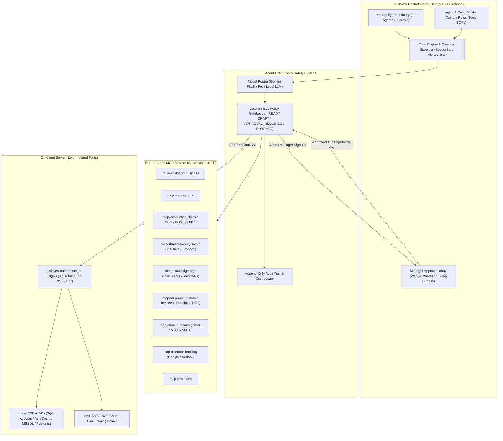
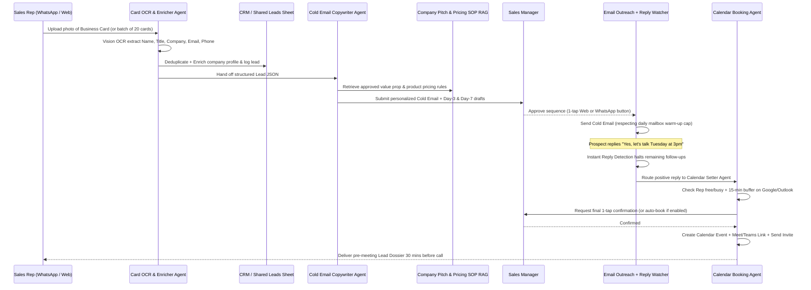

# AISlaves — Implementation Plan v2 (Crew Engine, MCP Hub & Pre-Configured Workforce)

**Product Vision:** A **CrewAI-style Multi-Agent Orchestration & Pre-Configured AI Employee Platform** paired with a **First-Party MCP Server Hub** built specifically for SMEs and mid-market businesses.  
**Delivery Model:** **Hybrid Cloud Control Plane** (Next.js 16 + Firebase + Cloud MCP Hub) + **Lightweight On-Premises Docker Edge Runner** (`aislaves-runner`) for client servers, legacy ERPs, and local shared Excel folders.

---

## 1. CrewAI-Style Multi-Agent Architecture & Dynamic Spawner (`packages/crew-engine`)

Rather than hardcoding brittle single-purpose workflows or exposing raw chat prompts, every automation in **AISlaves** runs on four composable TypeScript primitives:

1. **`Agent`**
   - `id`, `orgId`, `name`, `department`
   - `role`, `goal`, `backstory` (structured system persona)
   - `sopCollectionIds`: which Company Policy / Guide / SOP collections the agent can cite
   - `mcpToolAllowlist`: exact list of allowed MCP server tools and their maximum autonomy tier
   - `modelTier`: `gemini-flash` (fast OCR/triage/classification) vs `gemini-pro` (financial variance, complex negotiations, Manager coordination) vs `local-ollama` (strict on-prem)
   - `canDelegate`: boolean enabling dynamic sub-agent spawning / delegation
   - `maxSteps` (hard loop circuit breaker, e.g., `15`) & `maxRunCostMyr`

2. **`Task`**
   - `description`, `assignedAgentId`
   - `expectedOutputSchema`: strict Zod schema enforced via Gemini structured JSON outputs
   - `dependsOnTaskIds`: DAG execution edges between agents inside a crew
   - `approvalPolicy`: `auto` (`READ` / `DRAFT` only) or `require_approval` (`WRITE`)

3. **`Crew`**
   - `processMode`:
     - `sequential`: Pipeline handoff (`Card OCR -> Lead Enricher -> Cold Email Drafter -> Queue`).
     - `hierarchical`: Auto-appointed **Manager Agent** decomposes a complex brief, delegates tasks to specialist agents, verifies Zod outputs against SOPs, and retries on schema/policy mismatch.
     - `event_triggered`: Fires automatically on WhatsApp message, incoming email reply, POS end-of-day close, or uploaded file in the Shared Bookkeeping folder.
   - `CrewMemory`: Short-term run state (Firestore run steps), Long-term entity memory (known vendors, repeat leads, customer preferences), and Company SOP RAG context.

4. **Dynamic Agent Spawner & Template Cloner**
   - **Human Spawning:** Clients browse the **Pre-Configured Library**, click **Hire Agent** or **Hire Crew**, bind their MCP connectors, review default safety caps, and launch in minutes.
   - **Dynamic Sub-Agent Fan-Out:** Authorized Manager Agents can call `crew.spawnWorkerTask(...)` when batch events arrive (e.g., user drops 40 trade-show business card photos in WhatsApp → Coordinator spawns 40 isolated Card-to-Lead research + draft email workers in parallel).
   - **Hard Safety Bounds:** `maxSpawnDepth = 2` (workers cannot infinitely spawn sub-workers), `maxConcurrentSpawns` per org, and org daily token budget caps.



---

## 2. First-Party MCP Server Hub (`packages/mcp-servers/*`) + External MCP Support

All tools use the **Model Context Protocol (MCP)** so both **built-in SME connectors** and **any third-party community/client MCP server** share one uniform registry, schema contract, and **code-enforced Policy Gatekeeper** (`READ`, `DRAFT`, `APPROVAL_REQUIRED`, `BLOCKED`):

| MCP Server | Supported Platforms & Data | Key MCP Tools Exposed | Policy Tiers |
| :--- | :--- | :--- | :--- |
| **`mcp-whatsapp-business`** | Meta WhatsApp Cloud API | `wa.listThreads`, `wa.downloadMedia`, `wa.draftReply`, `wa.sendMessage`, `wa.sendManagerApprovalCard` | Read (`auto`), Reply (`approval` or FAQ whitelist), Manager Approval Cards (`system`) |
| **`mcp-pos-systems`** | **StoreHub**, **Loyverse**, **Qashier**, **FeedMe POS**, **Shopify POS / Square**, **Xilnex / Zeoniq**, + Universal Daily Z-Report CSV/XLSX parser | `pos.getDailySalesSummary`, `pos.listOrders`, `pos.getPaymentBreakdown`, `pos.getLowStockItems`, `pos.parseZReportFile` | Strictly `READ` on POS (never alters live register prices without manager ERP flow) |
| **`mcp-accounting`** | Cloud: **Xero**, **QuickBooks Online**, **Bukku**, **Financio**, **Odoo**; On-Prem (via Edge Runner): **SQL Account**, **AutoCount** | `acct.listInvoices`, `acct.listVendors`, `acct.getAgingReport`, `acct.getTrialBalance`, `acct.stageDraftBill`, `acct.postJournal` | Reads (`auto`), Stage Draft (`draft`), Post/Finalize (`APPROVAL_REQUIRED`), Void/Delete (`BLOCKED` or Owner-only) |
| **`mcp-shared-excel`** | **Shared Bookkeeping Folder** on Google Drive, Microsoft OneDrive/SharePoint, Dropbox, or Local Windows/NAS SMB Share (Edge Runner) | `excel.listWorkbooks`, `excel.readSheetSchema`, `excel.queryRows`, `excel.appendStagingRows`, `excel.commitUpdateWithBackup` | Reads (`auto`), Append to AI-Staging tab (`draft`), Commit to master GL/Cashbook sheet (`APPROVAL_REQUIRED` + auto `.bak` snapshot) |
| **`mcp-knowledge-sop`** | **Company Policies, Guides & SOPs** (PDF, DOCX, XLSX pricing tables, Markdown) with Department RBAC (`all_staff`, `sales`, `finance`, `hr`) | `sop.searchPolicies`, `sop.getExactSection`, `sop.checkApprovalLimit`, `sop.listGuides` | `READ` strictly filtered by user/agent department scope; answers include mandatory doc + section citations |
| **`mcp-vision-ocr`** | Gemini Multimodal Vision + strict Zod extractors + confidence scoring | `ocr.parseBusinessCard`, `ocr.parseSupplierInvoice`, `ocr.parseExpenseReceipt`, `ocr.parseDeliveryOrder`, `ocr.parseBankStatement` | `READ` / `EXTRACT` (`auto`; low-confidence fields automatically flag human review) |
| **`mcp-email-outreach`** | **Gmail OAuth**, **Microsoft 365 / Outlook Graph**, custom SMTP/IMAP | `mail.searchInbox`, `mail.getThread`, `mail.draftColdEmail`, `mail.scheduleFollowUp`, `mail.sendApprovedEmail`, `mail.detectRepliesAndStop` | Thread read (`auto`), Draft (`draft`), Send (`APPROVAL_REQUIRED` by default; optional trusted-cadence toggle), Unsubscribe (`auto` + instant blocklist) |
| **`mcp-calendar-booking`** | **Google Calendar**, **Microsoft Outlook Calendar** | `cal.getFreeBusySlots`, `cal.proposeMeetingWindows`, `cal.bookAppointmentWithMeet`, `cal.rescheduleEvent` | Availability lookup (`auto`), Slot proposal (`draft` / included in email), Final Calendar Invite (`APPROVAL_REQUIRED` or `auto` within strict rep hours when prospect explicitly confirmed time) |
| **`mcp-crm-leads`** | Built-in Firestore Pipeline + bi-directional sync to Shared Leads Excel / HubSpot / Pipedrive | `crm.upsertLead`, `crm.logActivity`, `crm.updateStage`, `crm.checkDuplicateLead` | Deduplicates by email/domain/phone before any outreach starts |

In addition to these 9 built-in servers, clients and your brother's agency team can register **External Custom MCP Servers** (by HTTPS endpoint + bearer token, or local `stdio` inside the client's `aislaves-runner` Docker config) directly in the MCP Hub UI.

---

## 3. Pre-Configured Agent & Crew Library (12 Turnkey Templates)

Organize templates into 3 ready-to-sell commercial bundles combining every requested workflow with high-impact SEA/Malaysia SME automations:

### Bundle A — "Card-to-Calendar" Sales Growth Crew (4 Agents)



1. **Business Card OCR & Lead Enricher Agent** — Parses photos sent via WhatsApp or uploaded in bulk (tradeshow batches), validates email/domain, enriches company industry/size, deduplicates against CRM/Shared Excel, and writes structured contacts.
2. **Cold Outreach Copywriter Agent** — Queries `mcp-knowledge-sop` (Product Brochure, Case Studies, Pricing Rules) and drafts tailored first-touch emails referencing the event/pain point.
3. **Smart Follow-Up Cadence Agent** — Schedules Day-3 / Day-7 / Day-14 polite nudges, tracks opens/bounces, enforces opt-out compliance, and **immediately cancels future steps** the moment a human reply or Out-of-Office arrives.
4. **Inbox Reply & Calendar Appointment Setter Agent** — Classifies positive/objection/reschedule replies, inspects live availability across rep calendars, suggests concrete times in the prospect's timezone, books the slot + video conference link cleanly, and sends a WhatsApp summary to the sales rep.

### Bundle B — POS, Shared Excel Bookkeeping & Accounting Crew (5 Agents)

5. **POS-to-Excel & Accounting Daily Closing Agent** — Connects to StoreHub / Loyverse / Qashier / FeedMe / Shopify / Z-report folder each night; reconciles Cash, DuitNow QR, Card, E-Wallet, and Delivery totals; appends a daily summary row to the **Shared Bookkeeping Excel Workbook** (saving a `.bak` snapshot first); and stages the daily sales journal in Xero, Bukku, Odoo, SQL Account, or AutoCount.
6. **AP Invoice & Receipt Bookkeeper Agent** — Watches `accounts@...` inbox or a Shared Invoices folder; extracts vendor, invoice #, line items, SST, and due date via `mcp-vision-ocr`; matches against PO/Delivery Order; appends to the Shared AP Tracker Excel; and stages the bill for manager approval.
7. *(Added)* **Malaysia LHDN MyInvois (e-Invoice) & SST Compliance Agent** — Audits daily POS/Excel/Accounting records before submission to flag missing Buyer TIN, BRN/NRIC, MSIC code, classification codes, or SST math discrepancies early.
8. *(Added)* **AR Overdue Payment Chaser Agent** — Reads overdue aging tabs in Excel or Accounting software, groups invoices by 7 / 14 / 30+ days overdue, checks escalation SOP tone rules, and queues polite-to-firm WhatsApp & email reminders with Statement of Account attached.
9. *(Added)* **Marketplace & Delivery Payout Reconciler Agent** — Downloads or reads Shopee, Lazada, GrabFood, and Foodpanda settlement CSV/Excel drops, reconciles gross POS sales vs. commissions/vouchers vs. actual bank payout, and flags missing/underpaid settlements inside the Shared Reconciliation Excel workbook.

### Bundle C — Company SOP, Staff Claims & Executive Ops Crew (3 Agents)

10. **Company Policy, Guide & SOP Helpdesk Agent** — Lets staff ask operational, HR leave, onboarding, pricing discount, or SOP questions via Web chat or WhatsApp, returning crisp answers **strictly cited** to exact company documents/sections (with zero access to restricted Finance/HR payroll folders unless authorized).
11. *(Added)* **WhatsApp Staff Expense Claim & Delivery Order Verifier Agent** — Field/sales staff snap a receipt or signed Delivery Order on WhatsApp → Vision OCR extracts amount/merchant/date → checks against the Company Expense Policy SOP (e.g., max meal cap MYR 30, mileage rate, required client name) → logs compliant items into the Shared Claims Excel and sends a **1-tap Approve/Reject card to the manager on WhatsApp**.
12. *(Added)* **8:30 AM "Boss Daily Pulse" Briefing Agent** — Sends owners a crisp daily WhatsApp/email briefing every morning: yesterday's net POS sales by branch, cash collected vs pending e-wallets, overdue AR, flagged invoice discrepancies, pending approvals awaiting 1 tap, and today's sales appointments booked by the Calendar Setter.

---

## 4. Updated Firestore Data Model & Monorepo Architecture

```text
organizations/{orgId}
├── members/{uid}                       # owner | manager | finance_reviewer | sales_rep | staff
├── mcp_servers/{serverId}              # built-in or custom MCP config + connection health
├── role_templates/                     # global catalog + org custom clones
├── hired_agents/{employeeId}           # spawned/configured AI employees + tool/SOP bindings
├── hired_crews/{crewId}                # multi-agent crews (workflow mode, member IDs, schedules)
├── knowledge_collections/{colId}       # Policies / Guides / SOP vaults with department ACLs
│   └── chunks/{chunkId}                # indexed text + vector embeddings + doc page/section refs
├── shared_workbooks/{workbookId}       # Shared Drive / OneDrive / local SMB Excel registry + schema lock
├── leads/{leadId}                      # CRM / Business Card OCR records + deduplication hashes
├── outreach_sequences/{seqId}          # Cold email + follow-up state machine (stopped instantly on reply)
├── runs/{runId}                        # Crew & Agent run execution state + cost ledger
│   └── steps/{stepId}                  # Individual tool call trace & Zod validation output
├── approvals/{approvalId}              # Web + WhatsApp 1-tap decision queue + idempotencyKey
└── audit_logs/{auditId}                # Append-only immutable compliance & action ledger
```

---

## 5. Critical Engineering Guardrails for SME Reliability

1. **Zero-Corruption Shared Bookkeeping Excel Protocol (`mcp-shared-excel`)**
   - Always acquire a short lease lock before mutating a workbook.
   - Save an automatic timestamped backup copy (`/._aislaves_backups/<name>_<timestamp>.xlsx`) before committing edits.
   - Default to writing into a dedicated **`AI_Staging`** tab (or appending to locked columns only) and **never overwrite cells containing formulas (`=SUM(...)`, `=VLOOKUP(...)`)**.
   - Re-verify Excel row totals before queuing accounting bill creation.

2. **Anti-Spam Cold Outreach & Deliverability Protection (`mcp-email-outreach`)**
   - Enforce per-mailbox daily send caps (e.g., max 25–40 personalized cold emails/day during warm-up), randomized send jitter, and SPF/DKIM/DMARC readiness checks at onboarding.
   - Cold outreach batches default to **Human Manager Approval** of drafted personalized emails before the sequence goes live (optional auto-follow-up for pre-approved templates only).
   - **Instant Stop-on-Reply Guarantee:** Incoming Gmail/Graph webhook or 60-second poll marks `outreach_sequences.status = 'replied'` and cancels all queued follow-up jobs atomically before the Appointment Setter responds.

3. **Conflict-Free Calendar Booking (`mcp-calendar-booking`)**
   - Re-query `freebusy` immediately before calling `calendar.events.insert` (preventing double-booking if the rep accepted another meeting while the prospect took hours to reply).
   - Respect configured working hours, travel/prep buffers (`15` minutes before/after), and idempotency keys per email thread.

4. **Strict SOP RAG Boundaries (`mcp-knowledge-sop`)**
   - Tag every policy/guide collection (`public_sales`, `all_staff`, `finance_only`, `hr_confidential`).
   - Refuse answers unless grounded in retrieved citations; prompt-injection attempts inside customer emails or OCR'd PDFs cannot query restricted SOP tags.

---

## 6. Phased 12-Week Implementation Roadmap

### Phase 1 (Weeks 1–2): Monorepo, Multi-Tenant Auth & Crew/Agent Library UI
- Scaffold Next.js 16 + TypeScript + Tailwind v4 monorepo (`apps/web`, `packages/shared`, `packages/crew-engine`, `packages/mcp-servers/*`, `packages/edge-runner`).
- Firebase Auth + Multi-Tenant Org RBAC + Firestore security rules (`firestore.rules` delegated to `firestore-rules-author`).
- **Pre-Configured Library & Crew Studio UI:** 1-click **Hire Agent / Hire Crew**, Agent spawner configuration (SOP tags, MCP tools, autonomy gates), and Shared Excel / Policy upload pages.

### Phase 2 (Weeks 3–4): Crew Engine, Dynamic Spawner, Policy Gate & Approval Inbox *(Cloud MVP)*
- Implement `Sequential` + `Hierarchical` Crew orchestration, Gemini tool calling (`@google/genai`), loop/budget circuit breakers, and `spawnWorkerTask` fan-out.
- Build deterministic Policy Gatekeeper + idempotency enforcement + **Manager Approval Inbox** (Web UI + **1-tap WhatsApp interactive Approve/Reject** buttons) + Immutable Audit Viewer.

### Phase 3 (Weeks 5–7): Sales "Card-to-Calendar" Crew + Company SOP RAG Server
- Ship `mcp-vision-ocr` (Business Card OCR), `mcp-crm-leads`, `mcp-email-outreach` (Gmail + M365 + instant reply halt), `mcp-calendar-booking` (Google + Outlook + Meet/Teams invites), and `mcp-knowledge-sop` (PDF/DOCX/XLSX RAG with citations).
- Launch **Bundle A ("Card-to-Calendar" Crew)** + **Company SOP Helpdesk Agent** for live customer pilots.

### Phase 4 (Weeks 8–10): POS, Shared Bookkeeping Excel & Accounting Crew
- Ship `mcp-shared-excel` (Drive/OneDrive/local safe workbook engine with auto-backup & formula protection), `mcp-pos-systems` (**StoreHub**, **Loyverse**, **Qashier**, **FeedMe**, Shopify POS + universal Z-report parser), and `mcp-accounting` (**Xero**, **Bukku**, **Odoo**, **QuickBooks**).
- Add **Malaysia LHDN MyInvois Validator**, **WhatsApp Staff Claims Verifier**, **AR Payment Chaser**, and **8:30 AM Boss Daily Pulse**.

### Phase 5 (Weeks 11–12): On-Premises Docker Edge Runner, Stripe Billing & Agency Launch Kit
- Package `packages/edge-runner` (`aislaves-runner` Docker image) for client servers running **SQL Account**, **AutoCount**, local SMB Shared Excel folders, MSSQL/Postgres, or optional Ollama/vLLM local inference.
- Wire Stripe per-agent/per-crew monthly retainers + action/OCR metering (reusing Stripe billing patterns proven in `DataEcho`) and harden prompt-injection + load tests.

---

## 7. Commercial Packaging Advice

Sell **Pre-Configured Digital Teams** on monthly retainers rather than raw AI tokens:
- **Starter Sales Growth Pack** (*"Card-to-Calendar"* Crew — Business Card OCR + Cold Email/Follow-ups + Calendar Appointment Setter): Setup fee + monthly retainer per sales mailbox/rep.
- **Finance & POS Ops Pack** (*POS + Shared Excel + Accounting + LHDN MyInvois + Staff Claims*): Setup fee + monthly retainer per company/branch.
- **On-Premises Server Add-On** (*Docker Edge Runner* for SQL Account / AutoCount / Local SMB Excel / Private DBs): Higher-margin enterprise add-on.
