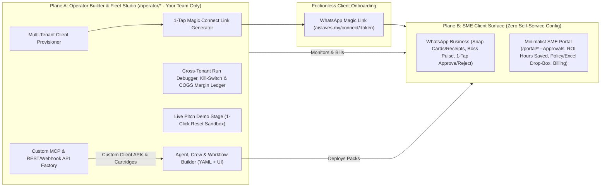
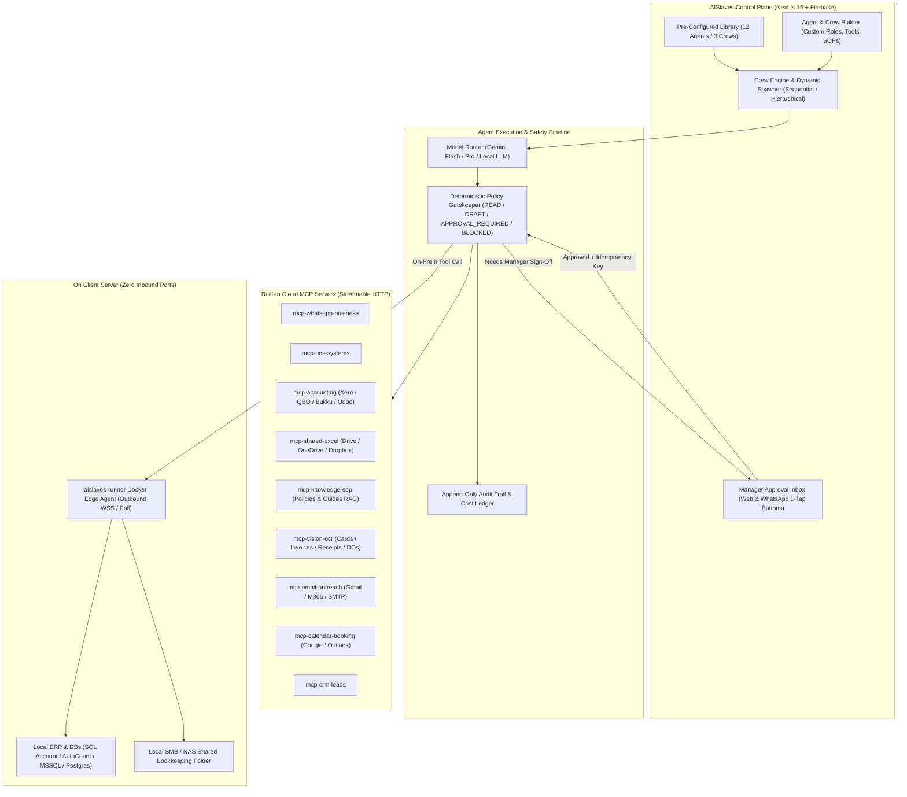
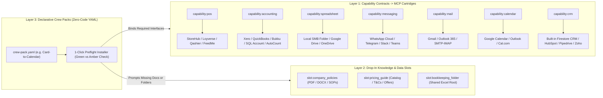
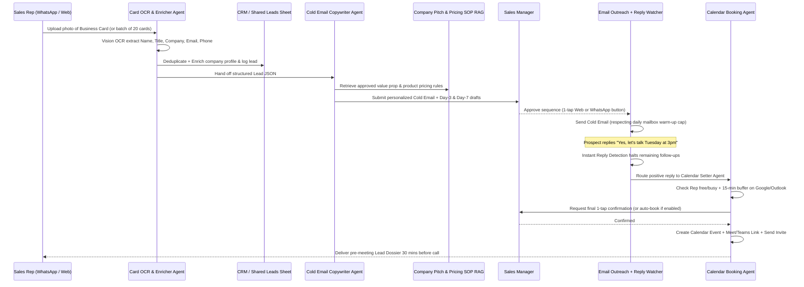

# AISlaves — Implementation Plan v2.2 (Operator-Managed SME Platform, Pricing & Demo Sandbox)

**Product Vision:** A **Done-For-You Managed AI Workforce & Plug-and-Play Agent Platform** built on a **CrewAI-style Orchestration Engine** and a **First-Party MCP Server Hub** — operated **by your agency team for SME clients** (zero SME self-service complexity).  
**Operating Model:** **Two-Plane Managed Service** — an internal **Operator Builder & Fleet Studio** (`/operator/*` where you build agents, workflows, custom MCP servers, and APIs for clients) + a **Zero-Config SME Supervision Surface** (**WhatsApp Business** + minimalist `/portal/*` ROI & Approvals dashboard).  
**Delivery Model:** **Hybrid Cloud Control Plane** (Next.js 16 + Firebase + Cloud MCP Hub + REST-to-MCP Bridge) + **Lightweight On-Premises Docker Edge Runner** (`aislaves-runner`) for client servers, legacy ERPs, and local shared Excel folders.

---

## 0. Two-Plane Managed Service Architecture (Operator Studio vs SME Supervision)

SME business owners do **not** want another dashboard where they must write prompts, wire JSON schemas, or debug API keys. They want to **pay an affordable monthly fee for reliable AI staff**, approve sensitive actions in 1 tap on WhatsApp, and track ROI.



### Plane A — Operator Builder & Fleet Studio (Internal Only)
- **Multi-Tenant Client Provisioner:** Create SME client workspaces (`tenants/{orgId}`), assign subscription tier + hard task allowance caps, clone vertical `crew-pack.yaml` blueprints, and track real-time client profitability (`Monthly Retainer - Gemini/WhatsApp/Cloud Run COGS`).
- **Visual & YAML Agent / Workflow Studio:** Tune agent personas, step limits, model routing (`Gemini Flash` vs `Gemini Pro`), schedules, and approval policies across your entire client fleet from one console.
- **Custom MCP & API Factory (`mcp-custom-rest-bridge` + Tenant Webhooks):**
  - Wrap any client's proprietary POS, booking system, warehouse software, or website backend into an Agent-callable **MCP Cartridge** simply by pasting an OpenAPI/cURL spec + auth header (Bearer/API Key/HMAC).
  - Expose dedicated per-tenant **Inbound Webhook & REST Trigger APIs** (`POST /api/v1/tenants/:slug/hooks/:triggerId`) so a client's website form, Shopify store, or ERP event triggers a Crew instantly.
- **1-Tap Magic Connect Links (`aislaves.my/connect/:token`):** When a client needs to authorize Gmail, Google Calendar, Xero, Bukku, or drop SOP PDFs, the operator texts them a single time-limited WhatsApp link. The boss logs in or drags-and-drops the PDF in 30 seconds without ever seeing the Agent/Workflow Builder.
- **Billing Kill-Switch & Fleet Safeguards:** Pause noisy triggers, enforce per-tenant monthly task/cost ceilings, replay failed runs step-by-step, and roll out template updates across multiple SME clients.

### Plane B — SME Client Surface (Zero Technical Complexity)
- **Primary UX is WhatsApp (90% of daily interaction):** Sales reps snap tradeshow business cards; site staff snap expense receipts or Delivery Orders; staff ask SOP policy questions; the boss receives the **8:30 AM Boss Daily Pulse** and taps `[Approve]` / `[Reject]` interactive buttons.
- **Minimalist Supervision Portal (`/portal/*`):** Read-only peace-of-mind portal locked behind org RBAC showing only:
  1. Pending Approvals Queue,
  2. Live Activity Feed & **"Hours Saved / MYR ROI" Counter**,
  3. Shared Policy/Excel Drop-Box (upload updated SOP PDFs or view backup snapshots),
  4. Invoices, Current Usage Bar, & Plan Subscription.

---

## 1. CrewAI-Style Multi-Agent Architecture & Dynamic Spawner (`packages/crew-engine`)

Rather than hardcoding brittle single-purpose workflows or exposing raw chat prompts, every automation in **AISlaves** runs on four composable TypeScript primitives:

1. **`Agent`**
   - `id`, `orgId`, `name`, `department`
   - `role`, `goal`, `backstory` (structured system persona)
   - `sopCollectionIds`: which Company Policy / Guide / SOP collections the agent can cite
   - `mcpToolAllowlist`: exact list of allowed MCP server tools and their maximum autonomy tier
   - `modelTier`: `gemini-flash` (fast OCR/triage/classification) vs `gemini-pro` (financial variance, complex negotiations, Manager coordination) vs `local-ollama` (strict on-prem)
   - `canDelegate`: boolean enabling dynamic sub-agent spawning / delegation
   - `maxSteps` (hard loop circuit breaker, e.g., `15`) & `maxRunCostMyr`

2. **`Task`**
   - `description`, `assignedAgentId`
   - `expectedOutputSchema`: strict Zod schema enforced via Gemini structured JSON outputs
   - `dependsOnTaskIds`: DAG execution edges between agents inside a crew
   - `approvalPolicy`: `auto` (`READ` / `DRAFT` only) or `require_approval` (`WRITE`)

3. **`Crew`**
   - `processMode`:
     - `sequential`: Pipeline handoff (`Card OCR -> Lead Enricher -> Cold Email Drafter -> Queue`).
     - `hierarchical`: Auto-appointed **Manager Agent** decomposes a complex brief, delegates tasks to specialist agents, verifies Zod outputs against SOPs, and retries on schema/policy mismatch.
     - `event_triggered`: Fires automatically on WhatsApp message, incoming email reply, POS end-of-day close, or uploaded file in the Shared Bookkeeping folder.
   - `CrewMemory`: Short-term run state (Firestore run steps), Long-term entity memory (known vendors, repeat leads, customer preferences), and Company SOP RAG context.

4. **Dynamic Agent Spawner & Template Cloner**
   - **Operator Provisioning:** Operators browse the **Pre-Configured Library** in `/operator`, click **Deploy Crew Pack** onto an SME tenant workspace, bind custom/built-in MCP Cartridges, issue a **Magic Connect Link** for client OAuth slots, verify safety caps, and launch in minutes.
   - **Dynamic Sub-Agent Fan-Out:** Authorized Manager Agents can call `crew.spawnWorkerTask(...)` when batch events arrive (e.g., user drops 40 trade-show business card photos in WhatsApp → Coordinator spawns 40 isolated Card-to-Lead research + draft email workers in parallel).
   - **Hard Safety Bounds:** `maxSpawnDepth = 2` (workers cannot infinitely spawn sub-workers), `maxConcurrentSpawns` per org, and org daily token budget caps.



---

## 1A. Plug-and-Play Architecture (3-Layer Zero-Code Standard)

To operate as true **"plug-and-play AI employees"** rather than custom agency integrations for every SME client, AISlaves separates **business logic (Crews & Agents)** from **vendor connectors (MCP Cartridges)** and **company context (Knowledge/Data Slots)**.

Think of it like **USB-C + Shopify App Store for Digital Workers**:
- Clients do **not** configure prompts or wire JSON schemas.
- Developers do **not** rewrite workflows when one client uses **StoreHub + Xero + Google Drive** and another uses **Loyverse + SQL Account + Local Windows Server Excel**.



### Layer 1: Hot-Swappable MCP Tool "Cartridges" (Capability Contracts)

Every Agent blueprint binds only to abstract **Capability Contracts** (`capability:*`), never to vendor-specific MCP tool names. Each MCP server in `packages/mcp-servers/*` registers as a hot-swappable **Cartridge** that implements one or more contracts via standardized normalized input/output JSON schemas.

| Capability Contract | Standardized Tool Interface (Used by Agents) | Hot-Swappable Cartridges (Per-Tenant Binding) |
| :--- | :--- | :--- |
| `capability:pos` | `get_daily_summary`, `list_shifts`, `get_item_sales`, `list_refunds_voids` | StoreHub, Loyverse, Qashier, FeedMe, Slurp, Generic CSV/Webhook POS |
| `capability:accounting` | `create_draft_bill`, `list_unpaid_invoices`, `record_payment_match`, `get_coa_accounts`, `validate_einvoice` | Xero, QuickBooks Online, Bukku, SQL Account (`aislaves-runner`), AutoCount (`aislaves-runner`) |
| `capability:spreadsheet` | `acquire_lock`, `read_sheet_summary`, `append_ledger_row`, `snapshot_backup`, `release_lock` | Local SMB/NAS Excel (`aislaves-runner`), Google Drive / Sheets, OneDrive / SharePoint Excel |
| `capability:messaging` | `send_template_message`, `send_approval_card`, `list_recent_threads`, `download_media` | WhatsApp Business Cloud API, Telegram Bot, Slack, Microsoft Teams |
| `capability:mail` | `send_email`, `create_draft`, `search_threads`, `get_thread`, `watch_replies` | Gmail OAuth, Microsoft 365 Graph Mail, Custom SMTP/IMAP |
| `capability:calendar` | `get_free_busy`, `list_slots`, `create_tentative_hold`, `book_event` | Google Calendar, Microsoft Outlook Calendar, Cal.com |
| `capability:crm` | `upsert_lead`, `log_activity`, `update_stage`, `list_stale_leads` | Built-in AISlaves CRM (Firestore), HubSpot, Pipedrive, Zoho CRM |

> **Why this matters:** Swapping a client from **Loyverse + Local Excel** to **StoreHub + Xero** updates one Cartridge binding row in Firestore (`tenants/{tenantId}/cartridges`). All 12 AI Employees and multi-agent Crews continue working untouched.

### Layer 2: Drop-In Knowledge & Data "Slots"

Crews declare typed **Slots** for tenant-specific unstructured policies and shared operational folders:

- `slot:company_policies`: HR, expense claims, DO/GRN verification rules, refund limits, escalation contacts.
- `slot:pricing_guide`: Product catalog, tier discounts, payment terms, case studies, approved objection-handling scripts.
- `slot:bookkeeping_folder`: Target shared folder (`\\server\Finance\Bookkeeping` via Docker Edge Runner, or Google Drive / OneDrive folder ID) plus naming rules and chart-of-accounts reference.
- `slot:brand_voice`: Tone rules, email signatures, WhatsApp reply sign-offs, preferred languages (English / BM / Chinese).

Operators upload documents directly in `/operator` or send the SME owner a **1-Tap Magic Connect Link** to drag-and-drop PDFs/DOCX or pick a shared folder cleanly. The platform handles chunking, tenant-isolated vector indexing, version pinning, and read-only citation retrieval automatically.

### Layer 3: Declarative Crew Packs (`crew-pack.yaml`) + 1-Click Preflight Installer

New AI departments and vertical bundles are authored as declarative YAML/JSON manifests (`packages/crew-packs/*.yaml`) with **zero custom core code**.

#### Example Pack Manifest: `packs/sales-card-to-calendar/crew-pack.yaml`

```yaml
id: sales-card-to-calendar
name: "Card-to-Calendar Sales Growth Crew"
version: 1.0.0
category: sales
description: "Snap a business card or drop a lead -> research prospect -> draft grounded outreach & follow-ups -> book calendar slots on positive reply."

requiredCapabilities:
  - capability:messaging   # Receive card photos & send 1-tap WhatsApp approvals
  - capability:mail        # Read/write/send cold outreach & follow-up threads
  - capability:calendar    # Check free/busy & place holds / book meetings
  - capability:crm         # Deduplicate contacts & track funnel stages

optionalCapabilities:
  - capability:spreadsheet # Optional: also log exhibition leads to a master Excel sheet

knowledgeSlots:
  - id: pricing_guide
    label: "Products, Pricing Tiers & Pitch Deck (PDF/DOCX)"
    required: true
  - id: company_policies
    label: "Sales SLA, Discount Limits & T&Cs"
    required: false

triggers:
  - id: on_business_card_photo
    source: capability:messaging
    event: media.image.received
    filter: "tag:card OR channel:sales-leads"
  - id: on_prospect_reply
    source: capability:mail
    event: thread.reply.received
  - id: daily_followup_sweep
    type: cron
    schedule: "0 9 * * 1-5"

agents:
  - id: card_scout
    role: "Business Card OCR & Lead Enricher"
    uses: [capability:crm, capability:spreadsheet]
  - id: cold_writer
    role: "Outbound Sales Copywriter"
    uses: [capability:mail, capability:crm]
    slots: [pricing_guide, company_policies]
  - id: followup_nurturer
    role: "Follow-Up Cadence Specialist"
    uses: [capability:mail, capability:crm]
    slots: [pricing_guide]
  - id: calendar_closer
    role: "Reply Triage & Appointment Setter"
    uses: [capability:mail, capability:calendar, capability:crm]

tasks:
  - id: extract_and_enrich
    agent: card_scout
    trigger: on_business_card_photo
    outputTo: cold_writer
  - id: draft_intro_email
    agent: cold_writer
    after: extract_and_enrich
    requiresApproval: outbound_email_send
  - id: run_followup_touch
    agent: followup_nurturer
    trigger: daily_followup_sweep
    requiresApproval: outbound_email_send
  - id: propose_and_book_meeting
    agent: calendar_closer
    trigger: on_prospect_reply
    requiresApproval: calendar_booking_confirm

approvalGates:
  - outbound_email_send   # Preview recipient + subject + full body before sending
  - calendar_booking_confirm
```

#### 1-Click Operator Preflight & Magic Connect Onboarding

1. **Operator** selects the SME tenant workspace inside `/operator/tenants/:id` and clicks **Provision Crew Pack**.
2. Control plane evaluates `requiredCapabilities` + `knowledgeSlots` against the tenant's active **Cartridges** and **Knowledge Vault**:
   - **Green Badge:** Already connected (e.g., client previously authorized `Gmail` and `Google Calendar` — automatically reused).
   - **Amber Badge:** Missing dependency (e.g., `capability:messaging` not yet paired, legacy POS API needs mapping, or `slot:pricing_guide` empty).
3. For backend APIs/Docker Edge Runner, the **Operator** binds credentials or spins up a `custom-rest-bridge` adapter directly; for client-owned OAuth accounts (`Gmail`, `Calendar`, `Xero`, `Bukku`) or PDF uploads, the Operator clicks **Generate Magic Connect Link** and sends it to the SME owner on WhatsApp.
4. Once all required rows turn Green, preflight pings each Cartridge's healthcheck, validates write gates + billing caps, and flips the Crew from `staged` to `active`.

#### Vertical Pack Catalog (Built by Reusing the Same 7 Cartridges)

| Vertical Pack | Required Cartridges | Required Slots | Plug-and-Play Outcome |
| :--- | :--- | :--- | :--- |
| **Card-to-Calendar Sales Pack** | `messaging`, `mail`, `calendar`, `crm` | `pricing_guide`, `company_policies` | Snap card photo -> OCR -> grounded outreach -> follow-up -> booked calendar meeting |
| **F&B Chain POS & Bookkeeping Pack** | `pos`, `spreadsheet`, `accounting`, `messaging` | `bookkeeping_folder`, `company_policies` | Daily multi-outlet Z-report reconciliation -> void/discount anomaly alert -> locked Excel ledger + draft bills |
| **Trading & Wholesale Ops Pack** | `accounting`, `spreadsheet`, `messaging`, `mail` | `company_policies`, `pricing_guide`, `bookkeeping_folder` | PO/DO/Invoice 3-way check + MyInvois TIN prep + AR overdue WhatsApp chaser |
| **Agency Outbound & Retainer Pack** | `mail`, `calendar`, `crm`, `accounting`, `messaging` | `pricing_guide`, `company_policies` | Cold lead outreach + reply-to-meeting booking + monthly retainer invoice reminders |
| **Clinic & Service Centre Pack** | `messaging`, `calendar`, `pos`, `spreadsheet` | `company_policies`, `pricing_guide` | Appointment booking/rescheduling + POS daily cash-up + staff expense claim SOP triage |

---

## 2. First-Party MCP Server Hub (`packages/mcp-servers/*`) + External MCP Support

All tools use the **Model Context Protocol (MCP)** so both **built-in SME connectors** and **any third-party community/client MCP server** share one uniform registry, schema contract, and **code-enforced Policy Gatekeeper** (`READ`, `DRAFT`, `APPROVAL_REQUIRED`, `BLOCKED`):

| MCP Server | Supported Platforms & Data | Key MCP Tools Exposed | Policy Tiers |
| :--- | :--- | :--- | :--- |
| **`mcp-whatsapp-business`** | Meta WhatsApp Cloud API | `wa.listThreads`, `wa.downloadMedia`, `wa.draftReply`, `wa.sendMessage`, `wa.sendManagerApprovalCard` | Read (`auto`), Reply (`approval` or FAQ whitelist), Manager Approval Cards (`system`) |
| **`mcp-pos-systems`** | **StoreHub**, **Loyverse**, **Qashier**, **FeedMe POS**, **Shopify POS / Square**, **Xilnex / Zeoniq**, + Universal Daily Z-Report CSV/XLSX parser | `pos.getDailySalesSummary`, `pos.listOrders`, `pos.getPaymentBreakdown`, `pos.getLowStockItems`, `pos.parseZReportFile` | Strictly `READ` on POS (never alters live register prices without manager ERP flow) |
| **`mcp-accounting`** | Cloud: **Xero**, **QuickBooks Online**, **Bukku**, **Financio**, **Odoo**; On-Prem (via Edge Runner): **SQL Account**, **AutoCount** | `acct.listInvoices`, `acct.listVendors`, `acct.getAgingReport`, `acct.getTrialBalance`, `acct.stageDraftBill`, `acct.postJournal` | Reads (`auto`), Stage Draft (`draft`), Post/Finalize (`APPROVAL_REQUIRED`), Void/Delete (`BLOCKED` or Owner-only) |
| **`mcp-shared-excel`** | **Shared Bookkeeping Folder** on Google Drive, Microsoft OneDrive/SharePoint, Dropbox, or Local Windows/NAS SMB Share (Edge Runner) | `excel.listWorkbooks`, `excel.readSheetSchema`, `excel.queryRows`, `excel.appendStagingRows`, `excel.commitUpdateWithBackup` | Reads (`auto`), Append to AI-Staging tab (`draft`), Commit to master GL/Cashbook sheet (`APPROVAL_REQUIRED` + auto `.bak` snapshot) |
| **`mcp-knowledge-sop`** | **Company Policies, Guides & SOPs** (PDF, DOCX, XLSX pricing tables, Markdown) with Department RBAC (`all_staff`, `sales`, `finance`, `hr`) | `sop.searchPolicies`, `sop.getExactSection`, `sop.checkApprovalLimit`, `sop.listGuides` | `READ` strictly filtered by user/agent department scope; answers include mandatory doc + section citations |
| **`mcp-vision-ocr`** | Gemini Multimodal Vision + strict Zod extractors + confidence scoring | `ocr.parseBusinessCard`, `ocr.parseSupplierInvoice`, `ocr.parseExpenseReceipt`, `ocr.parseDeliveryOrder`, `ocr.parseBankStatement` | `READ` / `EXTRACT` (`auto`; low-confidence fields automatically flag human review) |
| **`mcp-email-outreach`** | **Gmail OAuth**, **Microsoft 365 / Outlook Graph**, custom SMTP/IMAP | `mail.searchInbox`, `mail.getThread`, `mail.draftColdEmail`, `mail.scheduleFollowUp`, `mail.sendApprovedEmail`, `mail.detectRepliesAndStop` | Thread read (`auto`), Draft (`draft`), Send (`APPROVAL_REQUIRED` by default; optional trusted-cadence toggle), Unsubscribe (`auto` + instant blocklist) |
| **`mcp-calendar-booking`** | **Google Calendar**, **Microsoft Outlook Calendar** | `cal.getFreeBusySlots`, `cal.proposeMeetingWindows`, `cal.bookAppointmentWithMeet`, `cal.rescheduleEvent` | Availability lookup (`auto`), Slot proposal (`draft` / included in email), Final Calendar Invite (`APPROVAL_REQUIRED` or `auto` within strict rep hours when prospect explicitly confirmed time) |
| **`mcp-crm-leads`** | Built-in Firestore Pipeline + bi-directional sync to Shared Leads Excel / HubSpot / Pipedrive | `crm.upsertLead`, `crm.logActivity`, `crm.updateStage`, `crm.checkDuplicateLead` | Deduplicates by email/domain/phone before any outreach starts |
| **`mcp-custom-rest-bridge`** *(Operator API Factory)* | Any client REST / GraphQL / OpenAPI endpoint or Legacy Webhook | Dynamically generated typed tools from OpenAPI/cURL specs + inbound tenant trigger endpoints (`/api/v1/tenants/:slug/hooks/:id`) | Strictly scoped per tenant; outbound mutations require `APPROVAL_REQUIRED` by default |

In addition to these built-in servers, your operator team can turn any SME client's proprietary REST API into an MCP Cartridge in minutes via the **Custom MCP & API Factory**, or register **External Custom MCP Servers** (HTTPS endpoint + bearer token, or local `stdio` inside the client's `aislaves-runner` Docker config) directly inside the Operator Studio.

---

## 3. Pre-Configured Agent & Crew Library (12 Turnkey Templates)

Organize templates into 3 ready-to-sell commercial bundles combining every requested workflow with high-impact SEA/Malaysia SME automations:

### Bundle A — "Card-to-Calendar" Sales Growth Crew (4 Agents)



1. **Business Card OCR & Lead Enricher Agent** — Parses photos sent via WhatsApp or uploaded in bulk (tradeshow batches), validates email/domain, enriches company industry/size, deduplicates against CRM/Shared Excel, and writes structured contacts.
2. **Cold Outreach Copywriter Agent** — Queries `mcp-knowledge-sop` (Product Brochure, Case Studies, Pricing Rules) and drafts tailored first-touch emails referencing the event/pain point.
3. **Smart Follow-Up Cadence Agent** — Schedules Day-3 / Day-7 / Day-14 polite nudges, tracks opens/bounces, enforces opt-out compliance, and **immediately cancels future steps** the moment a human reply or Out-of-Office arrives.
4. **Inbox Reply & Calendar Appointment Setter Agent** — Classifies positive/objection/reschedule replies, inspects live availability across rep calendars, suggests concrete times in the prospect's timezone, books the slot + video conference link cleanly, and sends a WhatsApp summary to the sales rep.

### Bundle B — POS, Shared Excel Bookkeeping & Accounting Crew (5 Agents)

5. **POS-to-Excel & Accounting Daily Closing Agent** — Connects to StoreHub / Loyverse / Qashier / FeedMe / Shopify / Z-report folder each night; reconciles Cash, DuitNow QR, Card, E-Wallet, and Delivery totals; appends a daily summary row to the **Shared Bookkeeping Excel Workbook** (saving a `.bak` snapshot first); and stages the daily sales journal in Xero, Bukku, Odoo, SQL Account, or AutoCount.
6. **AP Invoice & Receipt Bookkeeper Agent** — Watches `accounts@...` inbox or a Shared Invoices folder; extracts vendor, invoice #, line items, SST, and due date via `mcp-vision-ocr`; matches against PO/Delivery Order; appends to the Shared AP Tracker Excel; and stages the bill for manager approval.
7. *(Added)* **Malaysia LHDN MyInvois (e-Invoice) & SST Compliance Agent** — Audits daily POS/Excel/Accounting records before submission to flag missing Buyer TIN, BRN/NRIC, MSIC code, classification codes, or SST math discrepancies early.
8. *(Added)* **AR Overdue Payment Chaser Agent** — Reads overdue aging tabs in Excel or Accounting software, groups invoices by 7 / 14 / 30+ days overdue, checks escalation SOP tone rules, and queues polite-to-firm WhatsApp & email reminders with Statement of Account attached.
9. *(Added)* **Marketplace & Delivery Payout Reconciler Agent** — Downloads or reads Shopee, Lazada, GrabFood, and Foodpanda settlement CSV/Excel drops, reconciles gross POS sales vs. commissions/vouchers vs. actual bank payout, and flags missing/underpaid settlements inside the Shared Reconciliation Excel workbook.

### Bundle C — Company SOP, Staff Claims & Executive Ops Crew (3 Agents)

10. **Company Policy, Guide & SOP Helpdesk Agent** — Lets staff ask operational, HR leave, onboarding, pricing discount, or SOP questions via Web chat or WhatsApp, returning crisp answers **strictly cited** to exact company documents/sections (with zero access to restricted Finance/HR payroll folders unless authorized).
11. *(Added)* **WhatsApp Staff Expense Claim & Delivery Order Verifier Agent** — Field/sales staff snap a receipt or signed Delivery Order on WhatsApp → Vision OCR extracts amount/merchant/date → checks against the Company Expense Policy SOP (e.g., max meal cap MYR 30, mileage rate, required client name) → logs compliant items into the Shared Claims Excel and sends a **1-tap Approve/Reject card to the manager on WhatsApp**.
12. *(Added)* **8:30 AM "Boss Daily Pulse" Briefing Agent** — Sends owners a crisp daily WhatsApp/email briefing every morning: yesterday's net POS sales by branch, cash collected vs pending e-wallets, overdue AR, flagged invoice discrepancies, pending approvals awaiting 1 tap, and today's sales appointments booked by the Calendar Setter.

---

## 4. Updated Firestore Data Model & Monorepo Architecture

```text
platform_operators/{uid}                # Agency operators (admin | builder | support)
demo_templates/{demoId}                 # Pre-seeded interactive demo snapshots (demo-kopikita | demo-apex)

tenants/{orgId}
├── subscription                        # planId, taskAllowance, tasksUsed, hardCapMyr, cogsLedgerMyr, status
├── members/{uid}                       # SME portal users ONLY (owner | manager | finance_reviewer | sales_rep)
├── magic_links/{tokenId}               # Time-limited 1-tap WhatsApp OAuth / SOP Drop-Box onboarding links
├── cartridges/{cartridgeId}            # Layer 1 bindings (capability:* -> specific MCP server + encrypted tokens)
├── custom_apis/{apiId}                 # Operator-defined OpenAPI/REST wrappers & inbound client webhook triggers
├── mcp_servers/{serverId}              # Built-in or custom MCP config + live health status
├── role_templates/                     # Global vertical crew-pack manifests + tenant-tuned overrides
├── hired_agents/{employeeId}           # Deployed AI employees + capability/slot bindings (operator-managed)
├── hired_crews/{crewId}                # Multi-agent crews (workflow mode, schedules, approval gates)
├── knowledge_collections/{colId}       # Policies / Guides / SOP slots with department ACLs
│   └── chunks/{chunkId}                # Indexed text + vector embeddings + doc page/section refs
├── shared_workbooks/{workbookId}       # Shared Drive / OneDrive / local SMB Excel registry + schema lock
├── leads/{leadId}                      # CRM / Business Card OCR records + deduplication hashes
├── outreach_sequences/{seqId}          # Cold email + follow-up state machine (stopped instantly on reply)
├── runs/{runId}                        # Crew & Agent execution trace + real Gemini/WhatsApp COGS breakdown
│   └── steps/{stepId}                  # Individual MCP tool call trace & Zod validation output
├── approvals/{approvalId}              # Web Portal + WhatsApp 1-tap decision queue + idempotencyKey
└── audit_logs/{auditId}                # Append-only immutable compliance & ROI metrics ledger
```

---

## 5. Critical Engineering Guardrails for SME Reliability

1. **Zero-Corruption Shared Bookkeeping Excel Protocol (`mcp-shared-excel`)**
   - Always acquire a short lease lock before mutating a workbook.
   - Save an automatic timestamped backup copy (`/._aislaves_backups/<name>_<timestamp>.xlsx`) before committing edits.
   - Default to writing into a dedicated **`AI_Staging`** tab (or appending to locked columns only) and **never overwrite cells containing formulas (`=SUM(...)`, `=VLOOKUP(...)`)**.
   - Re-verify Excel row totals before queuing accounting bill creation.

2. **Anti-Spam Cold Outreach & Deliverability Protection (`mcp-email-outreach`)**
   - Enforce per-mailbox daily send caps (e.g., max 25–40 personalized cold emails/day during warm-up), randomized send jitter, and SPF/DKIM/DMARC readiness checks at onboarding.
   - Cold outreach batches default to **Human Manager Approval** of drafted personalized emails before the sequence goes live (optional auto-follow-up for pre-approved templates only).
   - **Instant Stop-on-Reply Guarantee:** Incoming Gmail/Graph webhook or 60-second poll marks `outreach_sequences.status = 'replied'` and cancels all queued follow-up jobs atomically before the Appointment Setter responds.

3. **Conflict-Free Calendar Booking (`mcp-calendar-booking`)**
   - Re-query `freebusy` immediately before calling `calendar.events.insert` (preventing double-booking if the rep accepted another meeting while the prospect took hours to reply).
   - Respect configured working hours, travel/prep buffers (`15` minutes before/after), and idempotency keys per email thread.

4. **Strict SOP RAG Boundaries (`mcp-knowledge-sop`)**
   - Tag every policy/guide collection (`public_sales`, `all_staff`, `finance_only`, `hr_confidential`).
   - Refuse answers unless grounded in retrieved citations; prompt-injection attempts inside customer emails or OCR'd PDFs cannot query restricted SOP tags.

---

## 6. Phased 12-Week Implementation Roadmap

### Phase 1 (Weeks 1–2): Operator Multi-Tenant Studio, Magic Links & Demo Sandbox
- Scaffold Next.js 16 + TypeScript + Tailwind v4 monorepo (`apps/web` with `(operator)`, `(portal)`, `(demo-stage)` route groups, `packages/shared`, `packages/crew-engine`, `packages/mcp-servers/*`, `packages/demo-sandbox`, `packages/edge-runner`).
- Firebase Auth + Multi-Tenant Org RBAC (`platform_operators` vs SME portal `members`, with `firestore.rules` delegated to `firestore-rules-author`).
- **Operator Studio MVP:** Multi-tenant client provisioner, Agent/Crew YAML & form builder, **1-Tap Magic Connect Link** generator, and Client Supervision Portal (`/portal/*`).
- **Pre-Configured Interactive Demo Stage (`/operator/demo-stage`):** Seed `demo-kopikita` & `demo-apex` tenants + deterministic `mock-*` Cartridges + 1-click `< 2s` reset so your brother can pitch live prospects from Week 2.

### Phase 2 (Weeks 3–4): Crew Engine, Policy Gate, Custom API Factory & Approval Inbox *(Paid Pilot Ready)*
- Implement `Sequential`, `Hierarchical`, and `Event-Triggered` Crew orchestration, Gemini tool calling (`@google/genai`), loop/budget circuit breakers, and `spawnWorkerTask` fan-out.
- Build **`mcp-custom-rest-bridge` + Per-Tenant Inbound Webhook APIs** (`/api/v1/tenants/:slug/hooks/:triggerId`) so operators can wrap any client API into MCP tools without custom code.
- Build deterministic Policy Gatekeeper + idempotency enforcement + **Manager Approval Inbox** (Web Portal + **1-tap WhatsApp interactive Approve/Reject** buttons) + Tenant COGS & Billing Metering.

### Phase 3 (Weeks 5–7): Sales "Card-to-Calendar" Crew + Company SOP RAG Server
- Ship `mcp-vision-ocr` (Business Card OCR), `mcp-crm-leads`, `mcp-email-outreach` (Gmail + M365 + instant reply halt), `mcp-calendar-booking` (Google + Outlook + Meet/Teams invites), and `mcp-knowledge-sop` (PDF/DOCX/XLSX RAG with citations).
- Launch **Bundle A ("Card-to-Calendar" Crew)** + **Company SOP Helpdesk Agent** for paid SME pilot cohorts.

### Phase 4 (Weeks 8–10): POS, Shared Bookkeeping Excel & Accounting Crew
- Ship `mcp-shared-excel` (Drive/OneDrive/local safe workbook engine with auto-backup & formula protection), `mcp-pos-systems` (**StoreHub**, **Loyverse**, **Qashier**, **FeedMe**, Shopify POS + universal Z-report parser), and `mcp-accounting` (**Xero**, **Bukku**, **Odoo**, **QuickBooks**).
- Add **Malaysia LHDN MyInvois Validator**, **WhatsApp Staff Claims Verifier**, **AR Payment Chaser**, and **8:30 AM Boss Daily Pulse**.

### Phase 5 (Weeks 11–12): On-Premises Docker Edge Runner, FPX/DuitNow Stripe Billing & Scale
- Package `packages/edge-runner` (`aislaves-runner` Docker image) for client servers running **SQL Account**, **AutoCount**, local SMB Shared Excel folders, MSSQL/Postgres, or optional Ollama/vLLM local inference.
- Wire automated Stripe billing (Cards + **FPX** + **DuitNow QR**), usage allowance alerts, kill-switches, and prompt-injection/load hardening.

---

## 7. Affordable SME Managed-Service Pricing & Unit Economics

Because AISlaves is sold **done-for-you** to SMEs (not SaaS tooling), price it cleanly as **"AI Staff Salary"** anchored against real SME hiring costs — **zero per-token billing anxiety** for the SME, while preserving **85%–92% recurring gross margins** for your agency.

### Market Anchor & Your Actual Operator COGS
- **Real SME Cost of 1 Junior Accounts/Admin Clerk or SDR (Malaysia):** **MYR 2,800 – 4,500/month** all-in (salary + EPF/SOCSO/EIS + training + turnover, approx. USD 650–1,050/mo).
- **Your Direct COGS per Active SME Tenant (500–2,000 automated tasks/mo):**
  - **Gemini Models** (`Gemini 2.5 Flash` for 90% OCR/triage/RAG + `Gemini 2.5 Pro` for reasoning/copywriting): **MYR 10 – 30/mo** (`USD 2 – 7/mo`)
  - **Amortized Firebase + Cloud Run + Vector Storage:** **MYR 15 – 25/mo** (`USD 3 – 6/mo`)
  - **WhatsApp Cloud API Utility/Service Conversations:** **MYR 15 – 40/mo** (`USD 3 – 9/mo`)
  - **Total Direct Monthly COGS:** **~MYR 40 – 95/mo (`USD 9 – 22/mo`) -> 85%–92% Gross Margin per Client**

### Recommended SME Retainer Tiers (Predictable "Digital Staff" Packaging)

| Plan | Monthly Retainer | Done-For-You Setup Fee | Included AI Workforce & Connections | Fair-Use Task Allowance | Ideal SME Buyer |
| :--- | :--- | :--- | :--- | :--- | :--- |
| **14-Day Paid Pilot** *("Test-Drive 1 AI Clerk")* | **MYR 299** *one-time (USD 69)* | Included *(100% credited to full setup if converted)* | 1 turnkey workflow connected cleanly (*Card-to-Calendar* OR *POS Daily Close* OR *SOP & Claims*) | Up to 150 completed tasks | Skeptical SME owner who wants proof on real data first |
| **Starter** *("Single AI Clerk")* | **MYR 399/mo** *(USD 89/mo)* | **MYR 800** *(waived on 12-mo prepay)* | 1 AI Employee Pack, up to 2 app Cartridges, WhatsApp 1-tap approvals, `/portal` ROI view | **500 tasks/mo** *(approx. MYR 0.80/task)* | Solo clinics, insurance/property teams, single-stall F&B |
| **SME Growth** *("Department AI Crew" — Core Offer)* | **MYR 899/mo** *(USD 199/mo)* | **MYR 1,800** *(~USD 400)* | 1 Full Crew Pack (4–5 Agents) + **Company SOP Vault** + **8:30 AM Boss Daily Pulse**, up to 5 Cartridges, monthly operator tuning | **2,000 tasks/mo** *(approx. MYR 0.45/task)* | 10–50 staff SMEs needing full Sales OR Finance ops coverage |
| **Pro Back-Office** *("Full AI Workforce + On-Prem")* | **MYR 1,699/mo** *(USD 379/mo)* | **MYR 3,500** *(~USD 780)* | All 3 Crews (12 AI Employees), up to 3 branches/mailboxes, **Docker Edge Runner** (`SQL Account` / `AutoCount` / NAS Excel), 1 Custom REST API wrapper included | **6,000 tasks/mo** + Priority WhatsApp SLA | Multi-outlet F&B chains, trading/wholesale, manufacturing |

### Predictable Add-Ons & Hard-Cap Guardrails
- **Opt-In Task Top-Up Pack:** **+MYR 99 per 1,000 extra tasks** (when reaching 80% / 100%, the system alerts WhatsApp and pauses non-urgent background runs until topped up — **never** triggers unexpected overage bills).
- **Extra POS Branch or Sales Rep Mailbox:** **+MYR 149/mo** per additional outlet/rep.
- **Custom Legacy API / MCP Cartridge Build:** **MYR 1,200 – 2,500 one-time** via the Operator REST-to-MCP Studio *(once built for one client, that Cartridge becomes reusable IP for every future client using the same software)*.
- **Payment Rails:** Stripe Subscriptions supporting **FPX online banking, DuitNow QR, and Corporate Cards**, with automatic monthly PDF receipts.

---

## 8. Pre-Configured Live Sales Demo Environment ("Pitch-in-a-Box")

To close SME owners in a 10-minute coffee shop or Zoom meeting without fragile live API setups, AISlaves ships with a dedicated **Interactive Demo Sandbox** seeded via `pnpm seed:demo`.

### 1. Two Turnkey Pre-Seeded Demo SME Businesses
1. **`demo-kopikita` — "KopiKita Artisan Roasters Sdn Bhd" (3-Outlet Malaysian F&B Chain):**
   - **Pre-wired Data:** StoreHub mock daily Z-reports across 3 branches showing a realistic **MYR 142 cash-drawer vs DuitNow variance** at Subang outlet, real downloadable `KopiKita_Bookkeeping_2026.xlsx` workbook (with `AI_Staging` tab + formula cells preserved), Bukku/Xero supplier invoices, a **Malaysia LHDN MyInvois missing Buyer TIN** flag, a crumpled **RM 45 receipt** tested against the Company Claims SOP (`max meal RM 30`), and a pre-staged **8:30 AM Boss Daily Pulse**.
2. **`demo-apex` — "Apex Precision Packaging Sdn Bhd" (B2B Wholesale & Manufacturing):**
   - **Pre-wired Data:** `Apex_Catalog_Pricing_2026.pdf` SOP knowledge vault, 5 trade-show business cards (plus live OCR option), active Gmail/Calendar sandbox, and a paused **Card-to-Calendar** sequence awaiting either prospect reply or manager sign-off.

### 2. Deterministic Sandbox Cartridges (`packages/demo-sandbox`)
Every Capability Contract (`capability:pos`, `capability:accounting`, `capability:spreadsheet`, `capability:messaging`, `capability:mail`, `capability:calendar`, `capability:crm`) includes a **`mock-*` Sandbox Cartridge** backed by isolated Firestore demo collections and real sample `.xlsx`/`.pdf`/image fixtures. **Zero third-party OAuth failures** during live pitches.

### 3. Split-Screen "Live Pitch Stage" (`/operator/demo-stage`)
- **Left Pane (What the SME Boss Sees):**
  - **Interactive WhatsApp Phone Simulator:** Tap *"Send Sample Supplier Receipt"* or *"Send Business Card Photo"*, ask *"Can staff claim RM 60 Grab?"* (returns exact cited SOP clause), inspect the **Boss Daily Pulse**, and tap real interactive **`[Approve]` / `[Reject]`** buttons.
  - **Prospect Reply Simulator:** Click **"Simulate Prospect Reply ('Thursday 3pm works!')"** -> visibly halts Day-3/Day-7 follow-ups and books a Google Meet calendar hold in real time.
  - **Live Excel Diff & Backup Viewer:** Shows exact row appended to `AI_Staging` alongside the auto-generated `.bak` safety snapshot.
- **Right Pane (Behind-the-Scenes Proof & ROI Trust):**
  - Real-time multi-agent handoff timeline (`Card Scout` -> `Cold Writer` -> `Policy Gatekeeper` -> `Calendar Closer`), exact SOP citations used, deterministic `APPROVAL_REQUIRED` pause state, and a live **"Hours & MYR Saved This Month"** counter tied to the SME's branch count.

### 4. 1-Click `< 2s` Reset + "Live Business Card Hook"
- **1-Click Reset (`POST /api/operator/demo/reset`):** Wipes temporary demo approvals, Excel mutations, calendar bookings, and chat threads back to clean Day-1 pitch state in under 2 seconds between client meetings.
- **"Live Business Card Hook" Switch:** Toggle `mock-ocr` to **Real Gemini Vision OCR** mid-pitch so your brother can snap the **actual prospect's business card** with his phone — within 8 seconds, the demo extracts their real name/title/company, drafts a grounded outreach email using demo Company SOPs, and queues the approval card live on screen.
