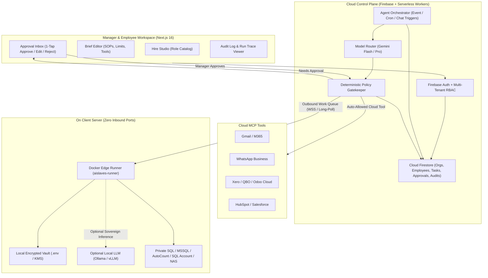
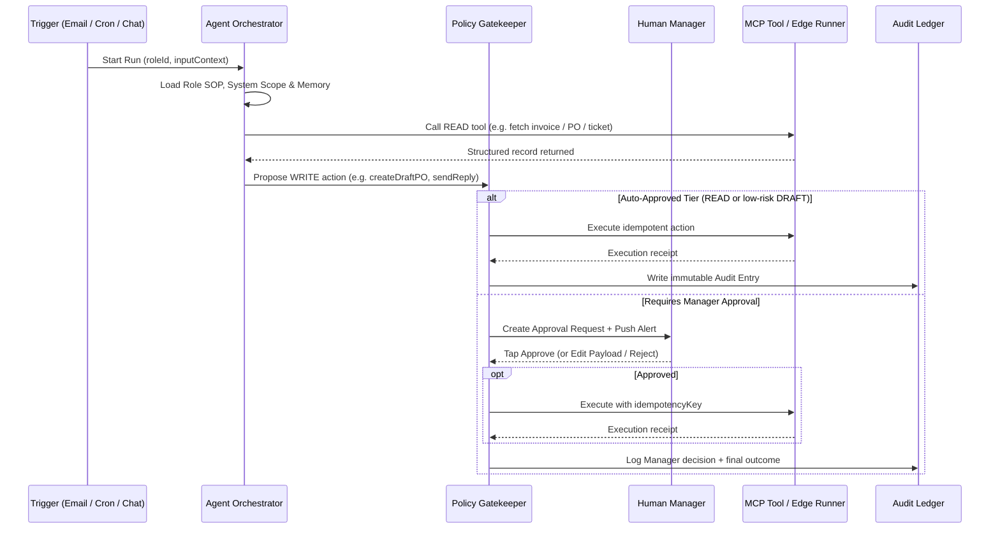

# AISlaves — Implementation Plan & Feasibility Analysis

**Business Model:** Agent-as-a-Service ("Hire · Brief · Supervise" AI Workforce)  
**Architecture:** Hybrid Multi-Tenant Cloud Control Plane (Next.js + Firebase) + Lightweight Client-Server Docker Edge Runner  
**Target Market:** SMEs & Mid-Market Enterprises needing role-based digital employees across Operations, Finance, Procurement, Customer Support, and Marketing — without losing human control or exposing internal servers.

---

## 1. Executive Feasibility Assessment ("How Easy Is This to Build?")

### Bottom-Line Verdict
- **Core Platform MVP ("Hire · Brief · Supervise" UI, agent loop, Approval Inbox, audit trail): Easy-to-Moderate (~3–4 weeks, ~3/10 engineering difficulty).**  
  Modern LLM SDKs (`@google/genai`), structured JSON tool calling, and MCP make building the agent orchestration loop and approval queue straightforward. Nobody needs to train a foundation model.
- **Production Enterprise Reliability & Connectors: Moderate-to-Hard (~7/10 difficulty, ~60% of ongoing effort).**  
  The true engineering effort — and the competitive moat that justifies recurring B2B retainers — lies in:
  1. **Messy Business System Connectors:** Integrating reliably with real SME tools (WhatsApp Business, M365/Gmail, Xero, Odoo, HubSpot, and Malaysian legacy on-prem systems like SQL Account, AutoCount, or self-hosted Postgres/MSSQL).
  2. **Deterministic Safety & Idempotency:** Guaranteeing an AI employee never double-sends an email, double-creates a Purchase Order, or posts an unapproved accounting journal entry.
  3. **Zero-Friction Client Server Runner:** Packaging the on-premises agent runner into a one-command Docker container so clients don't have to open firewall ports or share VPN credentials.

### Build vs. Reuse Advantage
Because the codebase follows a Next.js + Firebase Auth + Cloud Firestore + Stripe metering pattern alongside enterprise DB connectors (PostgreSQL, MSSQL, MySQL), existing auth/RBAC, Firestore rules, Stripe billing helpers, and SQL introspection patterns can be reused cleanly rather than built from scratch.

---

## 2. System Architecture

### Human-in-the-Loop (HITL) Execution Lifecycle

Every AI employee action passes through a strict state machine so **a person always stays in charge**:

### Policy Classification Matrix (Enforced in Code, Not Prompt-Only)

| Action Tier | Examples | Execution Rule |
| :--- | :--- | :--- |
| **`READ`** | Fetch ticket, read invoice PDF, query stock levels, pull P&L | Runs automatically within employee's org & table allowlist |
| **`DRAFT`** | Draft email reply, prepare quote comparison, save staged journal/PO | Creates a draft artifact without external side effects |
| **`APPROVAL_REQUIRED`** | Send email/WhatsApp, issue PO, post bill, write ERP table, spend above MYR 0 | Pauses run state (`awaiting_approval`), notifies manager with exact diff |
| **`BLOCKED`** | Delete historical records, drop tables, change bank details, modify RBAC | Hard-rejected by Policy Gatekeeper regardless of prompt output |

---

## 3. Multi-Tenant Firestore Data Model & Security Posture

All operational state lives in Cloud Firestore, strictly partitioned under `organizations/{orgId}` (or `org_id`-scoped collections with server-only Firebase Admin writes for run/audit integrity):

1. `organizations/{orgId}` — Organization profile, plan tier, active runner status, Stripe customer ID.
2. `organizations/{orgId}/members/{uid}` — Human users (`owner`, `manager`, `reviewer`, `viewer`), notification preferences, approval authority limits.
3. `role_templates/{templateId}` — Platform catalog of the 6 starter roles + vertical variants (system instructions template, required tool scopes, recommended schedule, default approval rules).
4. `organizations/{orgId}/ai_employees/{employeeId}` — Hired digital employee instance (display name, department, cloned SOP/brief, model preference, allowed connectors, schedule cron, spending/approval thresholds, `active | paused`).
5. `organizations/{orgId}/connectors/{connectorId}` — Cloud OAuth/API credentials (encrypted at rest via KMS / AES-256-GCM envelope encryption) OR reference IDs bound to an on-prem Edge Runner (secret stays on the client's server!).
6. `organizations/{orgId}/edge_runners/{runnerId}` — Registered client Docker agent (`runner_token_hash`, hostname, heartbeat timestamp, local capability manifest, version).
7. `organizations/{orgId}/runs/{runId}` — Execution record (`employee_id`, `trigger_type`, `status`: `running | awaiting_approval | completed | failed | cancelled`, token usage, started/finished timestamps).
8. `organizations/{orgId}/runs/{runId}/steps/{stepId}` — Step-by-step tool calls, latency, sanitized inputs/outputs, reasoning summary.
9. `organizations/{orgId}/approvals/{approvalId}` — Pending and historical manager decisions (`run_id`, `tool_name`, `human_summary`, `payload_snapshot`, `why_reason`, `idempotency_key`, `status`, `decided_by`, `decided_at`, `rejection_reason`).
10. `organizations/{orgId}/audit_logs/{auditId}` — **Append-only** immutable compliance log (never editable or deletable by any client).

---

## 4. The 6 Initial Department Roles — Implementation Blueprint

| Department Role | Trigger Sources | Cloud + Edge MCP Tools | Key Output Artifacts | Mandatory Approval Gates |
| :--- | :--- | :--- | :--- | :--- |
| **Customer Service Agent** | Shared Inbox / Gmail, WhatsApp Business webhook | `email.search`, `crm.getCustomer`, `orders.lookup`, `crm.createTicket`, `email.sendReply` | Triage tags, CRM note, drafted customer response | Sending outbound email/WhatsApp reply; any SLA escalation or refund |
| **Marketing Coordinator** | Weekly cron, competitor RSS/web search, GA4/Meta Ads | `web.search`, `analytics.getMetrics`, `docs.draftCampaign`, `cms.schedulePost` | Content calendar, competitor brief, campaign copy & ROI report | Publishing any external post/email campaign; budget modifications |
| **Production Planning Analyst** | Daily ERP sync cron, sales order webhook | `erp.getDemand`, `erp.getBOM`, `erp.getInventory`, `alerts.flagDelay` | Delay alerts, capacity bottlenecks, schedule rebalance proposal | Updating ERP work-order dates or priority overrides |
| **Procurement Officer** | Low-stock trigger, PR email/PDF, weekly reorder cron | `email.parseQuotes`, `erp.getVendors`, `erp.getStock`, `po.createDraft`, `po.issue` | 3-vendor comparison matrix, draft PO, vendor chase emails | Issuing RFQs to unapproved vendors; submitting any PO |
| **Accounting Clerk** | AP inbox (`accounts@...`), uploaded PDFs, bank CSV/feed | `vision.extractInvoice`, `erp.matchPO`, `bank.reconcileTx`, `ledger.stageBill` | Structured invoice extract, 2/3-way match flag, discrepancy report | Posting AP/GL entries; triggering payment batches |
| **Finance Analyst** | Monthly close cron, budget sheet / ERP ledger | `ledger.getActuals`, `budget.getPlan`, `finance.computeVariance`, `report.generate` | Budget-vs-actual variance memo, anomaly flags, forecast deck | Distributing executive reports externally; altering budget baselines |

> **Launch Recommendation:** Build **Accounting Clerk** and **Customer Service Agent** first. Every SME feels daily pain from invoice entry/matching and inbox/WhatsApp overload, making ROI immediately measurable within 14 days of a pilot.

---

## 5. Phased Delivery Roadmap (12 Weeks, Cloud MVP in 4 Weeks)

### Phase 1 (Weeks 1–2): Foundation, Multi-Tenancy & "Hire + Brief" Studio
- Bootstrap monorepo (`apps/web`, `packages/shared`, `packages/agent-core`, `packages/mcp-connectors`).
- Firebase Auth + Org Onboarding + RBAC (`Owner`, `Manager`, `Reviewer`) + strict Firestore rules.
- **Hire Studio UI:** Browse role catalog, instantiate an AI Employee, customize SOP brief, schedule, and tool permission toggles (`READ` vs `APPROVAL_REQUIRED`).
- **Deliverable:** Working web portal where clients create an org, hire/brief AI employees, and manage team permissions.

### Phase 2 (Weeks 3–4): Agent Runtime, Policy Gatekeeper & Approval Inbox *(Cloud MVP)*
- Build `agent-core` state machine powered by Gemini (`@google/genai`) with structured tool schemas, loop caps (max steps/tokens per run), and idempotency keys.
- Implement deterministic Policy Gatekeeper that pauses runs cleanly into Firestore `approvals` without losing context.
- Build **Manager Approval Inbox** (1-tap Approve, Edit-then-Approve, Reject with feedback to re-prompt the AI employee) + Web/Email notifications + **Immutable Activity Audit Viewer**.
- **Deliverable:** Sellable Cloud MVP capable of live pilot demos using Gmail/Workspace + mock/sandbox ERP connectors.

### Phase 3 (Weeks 5–7): First Two Revenue-Ready Department Packs
- **Pack A — Accounting Clerk:** Gemini Vision invoice PDF/image extraction → vendor/PO matching → discrepancy flagging → Xero / Odoo / CSV bill staging (with human approval before posting).
- **Pack B — Customer Service Officer:** Email / WhatsApp Business inbound triage → customer record lookup → drafted reply → manager 1-tap send approval.
- Add **Direct Conversational Brief & Supervision UI** (chat with an AI employee to assign ad-hoc tasks, inspect what it found, and ask follow-ups).

### Phase 4 (Weeks 8–10): Hybrid On-Premises Edge Runner (`"On Your Servers"`)
- Build `packages/edge-runner` as a lightweight Docker image (`aislaves-runner`):
  - Outbound-only HTTPS/WSS connection authenticated with scoped runner tokens (zero open inbound ports on the client's firewall).
  - Keeps private SQL Server / PostgreSQL / MySQL / SQL Account / AutoCount / Odoo local credentials 100% on the client's server.
  - Supports read-only SQL views & parameterized stored procedures for safe ERP queries.
  - Optional local inference adapter (Ollama / vLLM) so sensitive rows never leave client hardware when required.
- Add **Runner Health & Pairing UI** in the web portal (copy single `docker compose up -d` command + pairing token).

### Phase 5 (Weeks 11–12): Billing, Hardening & Agency Launch Kit
- Stripe billing integration:
  - Per-role monthly subscription ("AI Employee Salary") + optional usage metering / overage alerts.
- Security & reliability hardening:
  - Prompt-injection sanitization for untrusted external emails/PDFs (treating external content strictly as untrusted data, never instructions).
  - Concurrency locking & idempotency keys on all mutating tools.
  - Automated integration test suite for policy gates (`READ` / `APPROVAL_REQUIRED` / `BLOCKED`).
- Onboarding checklist + client demo environment with pre-seeded sample company data.

---

## 6. Commercial & Pricing Model (for an Agent-as-a-Service Business)

Competing effectively against custom dev agencies means selling **digital staff retainers**, not token API wrappers:

1. **One-Time Onboarding & Integration Setup Fee** (e.g., MYR 3,000 – MYR 10,000 per department):
   - Covers mapping the client's SOPs, configuring approval thresholds, connecting Cloud/On-Prem ERP, and validating the first 2 weeks of supervised runs.
2. **Monthly "AI Employee Salary" Retainer** (e.g., MYR 1,200 – MYR 3,500 / role / month depending on volume & on-prem runner):
   - Includes a generous monthly action allowance, SLA monitoring, continuous SOP tuning, and manager inbox access.
   - Positions the price favorably against hiring junior admin/coordinator headcount while keeping a human manager in full control.
3. **Why Hybrid Beats Pure Cloud or Pure On-Prem:**
   - **Pure on-prem everywhere** slows sales cycles and complicates updates, mobile push approvals, and Stripe billing.
   - **Hybrid (Cloud Control Plane + Docker Edge Runner)** gives instant SaaS onboarding on Day 1 for Gmail/WhatsApp/Xero clients, **plus** check-box data residency ("credentials & DB stay on your server") whenever an SME runs on-prem SQL Account, AutoCount, or private Postgres/MSSQL.

---

## 7. Key Technical Risks & Mitigations

| Risk | Impact | Concrete Mitigation |
| :--- | :--- | :--- |
| **Prompt Injection via Inbound Emails / PDFs** | Attacker emails an instruction trying to trigger transfers or data leaks | Isolate untrusted inputs inside tagged data blocks; enforce hard allowlists + mandatory human approval for all external writes |
| **Duplicate Actions on Retries** | Double POs, duplicate invoices, duplicate emails | Require deterministic `idempotency_key` (`runId + stepIndex + tool + targetId`) checked before executing any write tool |
| **Hallucinated IDs or Amounts** | Agent guesses a vendor ID or wrong invoice total | Enforce Zod schema validation and require tool-backed foreign keys (`vendor_id` must come from an earlier `READ` step) |
| **Runaway Token / Step Loops** | High LLM cost or stalled runs | Enforce hard `maxSteps` (e.g., 15) and `maxTokensPerRun` circuit breakers + per-org daily budget alerts |
| **Client Firewall Blocking Cloud Webhooks** | On-prem ERP unreachable from cloud | Edge Runner initiates **outbound** encrypted polling/WebSocket connection to Cloud Control Plane; zero inbound ports needed |
