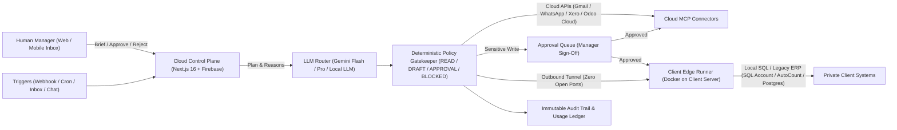

# AISlaves — Hybrid Agent-as-a-Service (AI Workforce) Platform

**Hire · Brief · Supervise** role-based digital employees across your business systems — with human-in-the-loop approvals, full audit logs, and optional on-premises execution on client servers.

> Read the full engineering, security, commercial, and 12-week delivery roadmap in [IMPLEMENTATION_PLAN.md](./IMPLEMENTATION_PLAN.md).

---

## What It Does

Instead of selling raw chatbots or prompt boxes, **AISlaves** packages autonomous AI workflows as **AI Employees** with clear job descriptions, scoped system permissions, a human manager, and mandatory approval gates before high-impact actions execute:

1. **Hire:** Pick a pre-built department role template (or customize one) with a defined job scope, schedule/triggers, and tool allowlist.
2. **Brief:** Configure SOPs, escalation thresholds, budget/authority limits, and connect business systems (Gmail/M365, WhatsApp, CRM, Odoo/Xero/Accounting/ERP, internal SQL databases).
3. **Supervise:** Every draft, PO, email reply, journal entry, or database write is governed by a deterministic policy gatekeeper — safe reads run autonomously, while sensitive writes pause in the **Manager Approval Inbox** with full context, payload diff, and one-tap Approve/Reject controls plus an immutable audit trail.

---

## Hybrid Architecture (Cloud Control Plane + Client Edge Runner)



---

## Initial Department Role Catalog (6 Roles)

| Department | Role Focus | Core Automated Tasks | Mandatory Approval Gate |
| :--- | :--- | :--- | :--- |
| **Customer Service** | Support & Triage Officer | Triage enquiries, look up order/ticket records, draft replies, follow up, update CRM, escalate exceptions | Sending external refunds/cancellations or VIP escalations |
| **Marketing** | Campaign & Research Coordinator | Monitor competitors, plan content calendars, draft campaigns, summarize funnel/ad analytics, nurture leads | Publishing external posts, ad spend changes, bulk outreach |
| **Production Planning** | Scheduling & Capacity Analyst | Review demand & BOMs, inspect material stock & capacity, flag bottlenecks, propose schedule shifts | Modifying confirmed production orders or shop-floor schedules |
| **Procurement** | Purchasing & Vendor Coordinator | Source suppliers, compare 3-way quotes, draft POs, follow up ETA delays, track bills & stock reorder points | Sending RFQs above limit, issuing/approving Purchase Orders |
| **Accounting** | AP/AR & Reconciliation Clerk | Extract invoices/receipts via vision OCR, reconcile bank/ledger transactions, track payables, flag anomalies | Posting general ledger / AP bills, payment batches |
| **Finance Analysis** | FP&A & Variance Analyst | Actual-vs-budget variance reports, anomaly & cashflow alerting, rolling forecasts, executive weekly brief | Sharing board/investor packs or updating official budgets |

---

## Proposed Monorepo Structure

```text
aislaves/
├── apps/
│   └── web/                    # Next.js 16 Control Plane (Org Admin, Brief Studio, Approval Inbox, Audit UI)
├── packages/
│   ├── agent-core/             # Agent loop, policy gatekeeper, idempotency, state machine
│   ├── mcp-connectors/         # Standardized MCP tool adapters (Email, WhatsApp, Xero, Odoo, CRM, SQL)
│   ├── edge-runner/            # Lightweight Docker worker for on-premises ERP/DB connectivity
│   └── shared/                 # TypeScript domain schemas, Firestore converters, Zod validators
├── firestore.rules             # Multi-tenant organization & role-based security rules
├── firestore.indexes.json      # Composite indexes for approval queues & audit logs
├── IMPLEMENTATION_PLAN.md      # Full feasibility, architecture, data model & 12-week roadmap
└── README.md
```

---

## Target Tech Stack

- **Web Control Plane:** Next.js 16 (App Router), React 19, TypeScript, Tailwind CSS v4
- **Auth & Database:** Firebase Authentication + Cloud Firestore (strict multi-tenant org isolation)
- **AI / Reasoning:** Google Gemini API (`@google/genai` — Gemini Flash for high-volume triage/OCR, Gemini Pro for complex planning/variance analysis) + optional local Ollama/vLLM via Edge Runner
- **Tool Protocol:** Model Context Protocol (MCP) for uniform, inspectable, per-tool permission enforcement
- **On-Premises Connectivity:** Lightweight Docker Edge Runner (`aislaves-runner`) connecting outbound over HTTPS/WSS with local secret storage (no inbound firewall ports required on client servers)
- **Billing:** Stripe subscriptions per hired AI employee ("digital salary") + token/action metering

---

## Documentation

- [Implementation Plan & Feasibility Study](./IMPLEMENTATION_PLAN.md)
