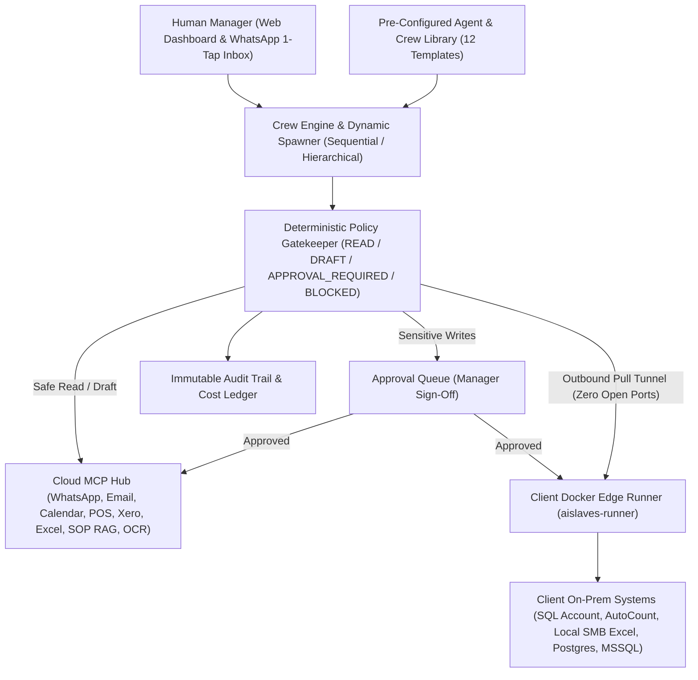

# AISlaves — Operator-Managed Plug-and-Play AI Workforce Platform & MCP Hub

**Build · Plug · Manage · Bill** pre-configured AI Employees and multi-agent Crews for **SME clients (Done-For-You Managed Service, zero SME self-service)** — built on a **3-Layer Plug-and-Play Architecture** ("Shopify App Store / Lego Bricks for AI Employees"), an internal **Operator Builder & Custom API Studio**, **1-tap WhatsApp Approvals**, safe **Shared Excel Bookkeeping**, **POS & Accounting integrations**, **Company SOP RAG**, a **"Card-to-Calendar" Sales Crew**, and a **Pre-Configured Live Demo Stage**.

> Read the full engineering specification, two-plane operator/SME model, 3-layer plug-and-play contracts, affordable SME retainer pricing, and live demo sandbox spec in [IMPLEMENTATION_PLAN.md](./IMPLEMENTATION_PLAN.md).

---

## Core Platform Capabilities

0. **Two-Plane Managed Service (Operator Studio vs SME Supervision — Zero Self-Service)**
   - **Plane A — Operator Builder & Fleet Studio (`/operator/*`):** Internal console for your agency team to provision SME clients, wire Crew Packs, wrap bespoke SME REST APIs into MCP Cartridges (`mcp-custom-rest-bridge`), generate **1-Tap Magic Connect Links**, monitor runs/COGS margins, and enforce billing caps.
   - **Plane B — SME Client Experience (WhatsApp + Minimal `/portal/*`):** SME owners and staff never touch prompts or builders — 90% runs inside **WhatsApp** (snap cards/receipts, ask SOPs, receive Boss Daily Pulse, tap `[Approve]` / `[Reject]`) plus a clean Approvals & ROI Dashboard.

1. **3-Layer Plug-and-Play Standard (Zero-Code Client Onboarding)**
   - **Layer 1 — Hot-Swappable MCP Tool "Cartridges":** Agents bind only to normalized **Capability Contracts** (`capability:pos`, `capability:accounting`, `capability:spreadsheet`, `capability:messaging`, `capability:mail`, `capability:calendar`, `capability:crm`). Swap StoreHub <-> Loyverse <-> Qashier or Xero <-> Bukku <-> SQL Account or Local SMB Excel <-> Google Sheets without touching a single prompt.
   - **Layer 2 — Drop-In Knowledge & Data "Slots":** Packs declare named slots (`slot:company_policies`, `slot:pricing_guide`, `slot:bookkeeping_folder`). Clients simply drag-and-drop PDFs/DOCX or link a folder via a Magic Connect Link.
   - **Layer 3 — Declarative Crew Packs (`crew-pack.yaml`) & 1-Click Preflight Wizard:** Operator installs vertical packs (*Sales*, *F&B*, *Trading/Wholesale*, *Agency*, *Clinic*), sees **Green/Amber** dependencies, sends Magic Links for missing OAuth slots, and goes live.

2. **CrewAI-Style Multi-Agent Engine & Dynamic Spawner**
   - Define `Agent` (`role`, `goal`, `backstory`, `sopCollectionIds`, `mcpToolAllowlist`, `modelTier`), `Task` (`expectedOutputSchema`, `dependsOnTaskIds`, `approvalPolicy`), and `Crew` (`sequential`, `hierarchical` with a Manager Agent, or `event_triggered`).
   - Provision single AI Employees from a **12-template Pre-Configured Library** or fan out sub-agents dynamically (e.g., scanning 40 expo business cards and spawning 40 parallel research + cold-email tasks within concurrency and budget caps).

3. **First-Party MCP Hub + Custom API Factory (Cloud + Client-Server Edge Runner)**
   - Standardized Model Context Protocol servers with code-enforced permission tiers (`READ`, `DRAFT`, `APPROVAL_REQUIRED`, `BLOCKED`):
     - **`mcp-whatsapp-business`**: Customer triage, media intake (cards/receipts/DOs), and **1-tap Manager Approve/Reject interactive buttons inside WhatsApp**.
     - **`mcp-pos-systems`**: StoreHub, Loyverse, Qashier, FeedMe POS, Shopify POS/Square, Xilnex/Zeoniq + universal daily Z-report CSV/Excel drop parser.
     - **`mcp-accounting`**: Xero, QuickBooks Online, Bukku, Financio, Odoo Accounting + On-Premises **SQL Account** and **AutoCount** via the Docker Edge Runner.
     - **`mcp-shared-excel`**: Safe bookkeeping workbook engine for Google Drive, OneDrive/SharePoint, Dropbox, or local SMB shares (auto-backups before write, formula preservation, schema column locks).
     - **`mcp-knowledge-sop`**: Company Policies, Guides & SOP RAG Vault with department RBAC and mandatory document/section citations.
     - **`mcp-vision-ocr`**: Multimodal Gemini Vision OCR for Business Cards, Supplier Invoices, Crumpled Staff Receipts, Delivery Orders (DOs), and Bank Statements.
     - **`mcp-email-outreach`**: Gmail / M365 / SMTP cold email drafting, warm-up rate limits, Day-3/Day-7 follow-ups, and instant stop-on-reply detection.
     - **`mcp-calendar-booking`**: Google Calendar & Microsoft Outlook free/busy checks, slot proposals, and automatic invite + Meet/Teams link creation upon prospect confirmation.
     - **`mcp-crm-leads`**: Bi-directional Lead & Deal pipeline synced with CRM or Shared Excel Lead trackers.
     - **`mcp-custom-rest-bridge`**: OpenAPI/cURL-to-MCP Cartridge wrapper + per-tenant Inbound Webhook Trigger APIs for custom client systems.

4. **3 Turnkey Pre-Configured Crews (12 Digital Employees)**
   - **Bundle A — "Card-to-Calendar" Sales Growth Crew:** Business Card OCR & Enricher → Cold Outreach Copywriter (grounded in Company Pitch/Pricing SOP) → Smart Follow-Up Cadence Agent → Reply & Calendar Appointment Setter.
   - **Bundle B — POS, Shared Excel & Accounting Crew:** POS Daily Closing Agent → AP Invoice/Receipt Bookkeeper → **Malaysia LHDN MyInvois & SST Validator** → **AR Overdue Payment Chaser** → **Shopee/Lazada/GrabFood Payout Reconciler**.
   - **Bundle C — Company SOP, Claims & Executive Ops Crew:** Company SOP Helpdesk Agent → **WhatsApp Staff Expense Claim & DO Verifier** → **8:30 AM "Boss Daily Pulse" WhatsApp Briefing Agent**.

5. **Affordable SME "Digital Staff" Pricing (~85%–92% Gross Margin)**
   - **14-Day Paid Pilot:** `MYR 299` one-time (`150` tasks, credited toward setup).
   - **Starter (`Single AI Clerk`):** `MYR 399/mo` + `MYR 800` setup (`500` tasks/mo).
   - **SME Growth (`Department Crew`):** `MYR 899/mo` + `MYR 1,800` setup (`2,000` tasks/mo).
   - **Pro Back-Office (`Full Workforce + On-Prem Docker`):** `MYR 1,699/mo` + `MYR 3,500` setup (`6,000` tasks/mo).

6. **Pre-Configured Live Sales Demo Stage ("Pitch-in-a-Box")**
   - Two pre-seeded SME demo tenants (`demo-kopikita` 3-outlet F&B chain & `demo-apex` B2B wholesale), deterministic `mock-*` Cartridges across all 7 interfaces, Split-Screen WhatsApp/Inbox/Excel Simulator (`/operator/demo-stage`), **1-click `< 2s` reset**, and a **Live Business Card OCR Hook** toggle for on-the-spot pitches.

---

## Hybrid Architecture



---

## Proposed Monorepo Structure

```text
aislaves/
├── apps/
│   └── web/                          # Next.js 16 Control Plane:
│       ├── app/(operator)/           # Internal Operator Studio (Provisioner, Agent/API Builder, COGS Margin)
│       ├── app/(portal)/             # Minimal SME Client Supervision Portal (Approvals, ROI, Drop-Box, Billing)
│       ├── app/(demo-stage)/         # Split-Screen Live Sales Demo Simulator + 1-Click Reset
│       └── app/connect/[token]/      # 1-Tap WhatsApp Magic Connect OAuth & SOP Drop-Box Onboarding
├── packages/
│   ├── shared/                       # Shared Zod schemas, Capability Contracts, Firestore converters
│   ├── crew-engine/                  # CrewAI-style Orchestrator, Manager Delegation, Dynamic Spawner, Policy Gate
│   ├── crew-packs/                   # Declarative vertical crew-pack.yaml manifests
│   ├── demo-sandbox/                 # Pre-seeded demo tenants (KopiKita, Apex) + mock-* Cartridges + reset script
│   ├── mcp-servers/
│   │   ├── whatsapp-business/        # Meta Cloud API + Manager 1-tap approval buttons
│   │   ├── pos-systems/              # StoreHub, Loyverse, Qashier, FeedMe, Shopify/Square, Z-report parser
│   │   ├── accounting/               # Xero, QBO, Bukku, Financio, Odoo, SQL Account, AutoCount
│   │   ├── shared-excel/             # Safe snapshot + formula-preserving Excel & Sheets updater
│   │   ├── knowledge-sop/            # RBAC-scoped Policy/SOP/Guide PDF/Docx/Excel RAG server
│   │   ├── vision-ocr/               # Business Cards, Invoices, Receipts, DOs (Gemini Vision + Zod)
│   │   ├── email-outreach/           # Gmail/M365/SMTP cold sequences + reply listener + rate limiter
│   │   ├── calendar-booking/         # Google/Outlook Calendar free/busy + atomic booking + Meet/Teams link
│   │   ├── crm-leads/                # Pipeline tracker synced to HubSpot/Pipedrive or Shared Excel
│   │   └── custom-rest-bridge/       # Operator OpenAPI/REST-to-MCP wrapper & inbound webhook trigger bridge
│   └── edge-runner/                  # One-command Docker worker for client servers & on-prem ERP/SMB shares
├── firestore.rules                   # Strict multi-tenant org & operator vs portal RBAC security rules
├── firestore.indexes.json            # Composite indexes for approval queues, leads, and audit logs
├── IMPLEMENTATION_PLAN.md            # Complete v2.2 engineering, pricing & demo blueprint
└── README.md
```

---

## Documentation

- [Implementation Plan v2.2 (Operator Studio, 3-Layer Plug-and-Play, Affordable SME Pricing & Demo Sandbox)](./IMPLEMENTATION_PLAN.md)
